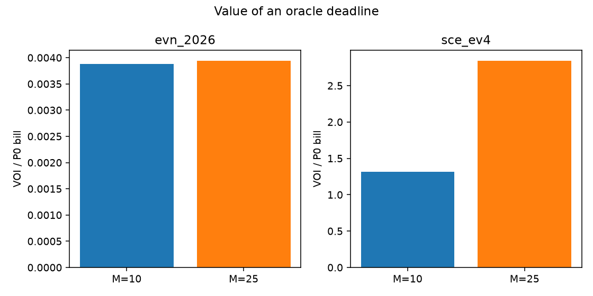
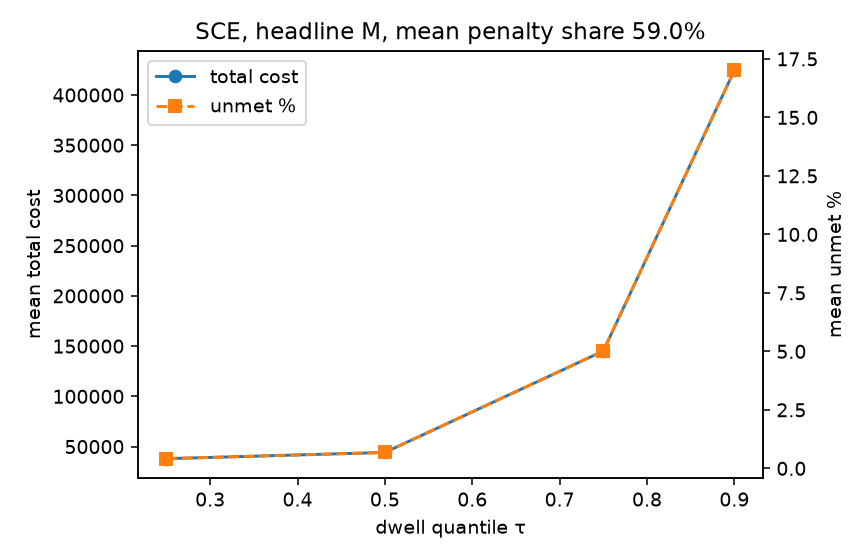

# EV Fleet Charging Intelligence

Workplace charging, from the plug event to a feasible schedule: mirror the sessions, audit them, then forecast and dispatch.

Day 1 delivers the mirror, the audit gate, and CI. The forecast tables and the first scheduler number are below. Simulation beyond the K=50 bank, and the API, are still stubs.

## Day 1

```bash
make install
make data      # Kaggle mirror (no token) + audit gate
make test
```

`ACN_DATA_TOKEN` switches the download to the Caltech API. Without it, the pipeline uses the public Kaggle mirror and recovers sessions from the truncated JSON instead of crashing.

Provenance on every generated artifact: `git_sha`, `config_hash`, `data_hash`, `utc_now`.

SCE and EVN prices in `configs/` are filed rates with source links in the YAML comments. SCE is TOU-EV-4 as of March 2019 (`sce_tou_ev_4_march_2019` in ACN-Sim). EVN energy uses the October 2025 trial bands and the QĐ 963 clock.

## Forecast (Day 2, v1)

Rolling-origin scores on `mirror_2018` (11 origins, 3696 hours). On that mirror, `primary_2019_06_2020_03` and `regime_2020_03` have 0 origins; the mirror ends 2018-11-13. Chronos was not fit. These rows are the information-asymmetric run: lag features inside the training window were null across the horizon.

| model | mean pinball | coverage | p-value vs naive |
|---|---:|---:|---:|
| seasonal-naive | 6.148 | 0.780 | baseline |
| LightGBM | 7.501 | 0.388 | 1.00 |
| ensemble | 5.778 | 0.738 | 0.0005 |

Equal-weight ensemble has the lowest mean pinball and beats seasonal-naive (p=0.0005); LightGBM alone is worse than seasonal-naive (p=1) and its q10-q90 coverage is 0.388, outside [0.70, 0.90].

## Forecast (Day 3, v2)

Same protocol on the B1+B2 series (`extended_2018_2020`, 65 origins, 21840 hours, 2018-04-25 through 2020-12-02). Embargo is still 336 hours and still restricts training rows only. Lag and rolling features at hour t use actuals before t. Chronos was not fit. The pre-registered primary and regime windows now contain 19 origins each; those counts are in `results/forecast_scores.csv` and were not fit a second time.

| model | mean pinball | coverage | p-value vs naive |
|---|---:|---:|---:|
| seasonal-naive | 3.779 | 0.823 | baseline |
| LightGBM | 2.407 | 0.753 | 0.0005 |
| ensemble | 2.891 | 0.835 | 0.0005 |

LightGBM has the lowest mean pinball and beats seasonal-naive (p=0.0005, improvement 36.3%). Its overall q10-q90 coverage is 0.753, inside [0.70, 0.90]. The equal-weight ensemble also beats seasonal-naive and loses to LightGBM. 24 of 65 origins have coverage outside [0.70, 0.90]; per-origin coverage and a null-feature fraction of 0 are in `results/forecast_diagnosis.csv`.

## Scheduler (Day 3)

P3 (LP-MPC) reaches cost 115.25 versus P0 128.23 on the day-1 scenario (−10.1%). Those dollars are the pre-verification rate card. Trace: `results/e2e_day3.csv`.

## Reproduction

Same frozen bank, filed SCE TOU-EV-4. The PSCC gap is (cost of P3 at T2 − cost of P4 at T3) / cost of P4. Minimum capacity is the smallest site cap that delivers every kWh the plugs can deliver. Trace: `results/reproduction.csv`.

| metric | literature | repo | delta |
|---|---:|---:|---:|
| PSCC gap, P3 T2 vs P4 T3 | 9.2% | 2918.4% | +2909.2 pp |
| minimum site cap, mean of the 50 years | 60 kW | 79.58 kW | +19.58 kW |

The repo gap is the ratio 29.184 stored in that CSV, which is 2918.4%. It was not tuned toward 9.2%. The bank year has no declared `userInputs`, so every T2 deadline is connection plus the 2019 Caltech median dwell, 5.27 hours, and unmet energy is priced at the frozen M = 1000 USD/kWh. Mean unmet is 11.0% of requested energy for P3 and 0.36% for P4.

Three ablations are in the same file. Removing the demand charge moves the ratio from 29.18 to 31.06, so the demand charge is not the source. Keeping only sessions whose imputed deadline falls inside the true stay moves it to 55.35, so early departures are not the source. P3 run with T3 information is the P4 schedule, and that gap is 0. The excess over 9.2% is the imputed deadline. The cap that serves every bank day, not the mean year, is 84.71 kW (+24.71 kW against 60). Those two deltas, +19.58 kW on the mean year and +24.71 kW on the bank-wide maximum, are attributed to the regime difference: this window and the kWh == 0 handling differ from the paper. Minimum capacity was not re-run.

## Results

### Plant-semantics fix

The plant now delivers until the recorded disconnect. A believed deadline is only a planning input (invariant I9). Day-4 and Day-5 unmet and penalty numbers are superseded. P0 unmet on the frozen bank falls from 18.7% to 0.36%. Predictions written before the re-run are in `results/day6_predictions.csv` (3 of 6 bands matched). Trace of the corrected bills: `results/m_sensitivity.csv`, `results/day6_comparison.csv`.

Interview numbers after the fix: (1) an oracle deadline is worth 284% of the P0 bill on SCE at M = 25 (VOI), (2) the smallest cap that serves the bank is still 79.6 kW, (3) P0 unmet 18.7% → 0.36%.

### Value of information

P3 is run twice on the same physical plant: T2 (imputed or declared deadline) versus T3 (oracle disconnect). VOI = cost(T2) − cost(T3). Energy is `kWhDelivered` on the frozen bank. M stays in {10, 25}. Trace: `results/voi.csv`, `results/voi_summary.csv`, tests in `results/voi_tests.csv`.



On SCE at M = 25, mean VOI is $103,995 per scenario year, 284% of the P0 bill (95% CI $102,873–$105,117, paired p = 2.8×10⁻⁷¹). T2 unmet is 4.80% and its penalty share is 80.4%, so this is an information gap priced at M, not a time-of-use saving. The 5,000-vehicle scale in the same file is $9.20 million per year under 200 sessions per vehicle per year; that commute assumption is labeled in `src/eci/eval/voi.py`. On EVN the same oracle is 0.39% of the P0 bill: M = 25 is far below the energy price, so a missed kWh is cheap in VND.

The declared-input split (`results/voi_ablation.csv`) names the expensive part. On SCE at M = 25, deadline information is $24,817 per year on that smaller bank versus $3,633 for `kWhRequested`. Deadline dominates. On EVN the deadline term is negative: a late belief skips expensive hours, the plant fails to deliver, and M = 25 does not make that failure expensive.

Takeaway: at this depot the dollar that moves the bill is a better departure time, not a smarter slot filler. P3 still matches P1 whenever the 150 kW cap does not bind.

### Risk dial

T2v2's random draw is replaced by a dwell quantile τ ∈ {0.25, 0.5, 0.75, 0.9} of the same station-hour CDF. Twenty scenarios, SCE, M = 25. Trace: `results/risk_dial.csv`.



The slope is wide and inverted. Raising τ from 0.25 to 0.90 drops energy cost from $8,632 to $6,239 and raises unmet from 0.41% to 17.0%. A later belief lets cheapest-slot wait for overnight off-peak; the car has already left. An operator who wants less unmet picks a short window and charges sooner. The dial is not a toggle.

### Cap sweep (re-verified)

Under the corrected plant the 150 kW / 1× sanity still holds: P3 ≡ P1, gap 0. At 4× arrivals and 60 kW the LP is 0.66% cheaper than greedy (p = 6.4×10⁻¹⁵). No cell in {60, 80, 100, 120, 150} × {1, 2, 4} saves 1% versus greedy, so there is still no break-even cap inside the grid. Figure: `plots/cap_sweep.png`. Trace: `results/cap_sweep.csv`.

The Day-5 M table that reported P3 unmet 23.1% is the plant-bug record and stays in git history. Corrected M = 25 on SCE: P0 unmet 0.36% (penalty share 22.8%), P3 unmet 4.80% (share 80.4%, reduction versus P0 −282.9%), P4 unmet 0.36% (share 23.2%, reduction +1.40%). P4's 1.4% is below the pre-registered 10–25% ToU band because the demand charge is most of the P0 bill; energy-only is about 5%. P3 is more expensive than P0: unmet risk of a wrong deadline costs more than the ToU saving. That comparison is not stated as a cost claim (P3 penalty share 80%).

### Reproduction v3

Same declared-departure bank as v2, plant on the physical plug. Gap 134.7% versus literature 9.2% (ratio 1.347 in `results/reproduction_v3.csv`). P3 unmet is 2.82%. Demand off → 453%; winter 142%; summer 91.9%. The leftover is energy the LP places after the true disconnect of a late declaration, still priced at M = 25. The v2 table (1,309%) is the plant-bug record.

CH-01, CH-06, and CH-08 pass with the corrected plant. CH-06 unmet is priced at M = 25 (8.5 kWh). Trace: `results/chaos_report.csv`.
