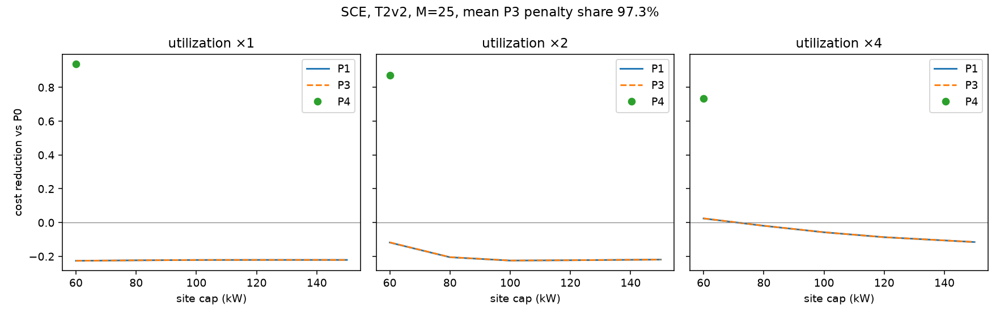

# EV Fleet Charging Intelligence

Workplace charging, from the plug event to a feasible schedule: mirror the sessions, audit them, then forecast and dispatch.

Day 1 delivers the mirror, the audit gate, and CI. The forecast tables and the first scheduler number are below. Simulation beyond the K=50 bank, and the API, are still stubs.

## Day 1

```bash
make install
make data      # Kaggle mirror (no token) + audit gate
make test
```

`ACN_DATA_TOKEN` switches the download to the Caltech API. Without it, the pipeline uses the public Kaggle mirror and recovers sessions from the truncated JSON instead of crashing.

Provenance on every generated artifact: `git_sha`, `config_hash`, `data_hash`, `utc_now`.

SCE and EVN prices in `configs/` are filed rates with source links in the YAML comments. SCE is TOU-EV-4 as of March 2019 (`sce_tou_ev_4_march_2019` in ACN-Sim). EVN energy uses the October 2025 trial bands and the QĐ 963 clock.

## Forecast (Day 2, v1)

Rolling-origin scores on `mirror_2018` (11 origins, 3696 hours). On that mirror, `primary_2019_06_2020_03` and `regime_2020_03` have 0 origins; the mirror ends 2018-11-13. Chronos was not fit. These rows are the information-asymmetric run: lag features inside the training window were null across the horizon.

| model | mean pinball | coverage | p-value vs naive |
|---|---:|---:|---:|
| seasonal-naive | 6.148 | 0.780 | baseline |
| LightGBM | 7.501 | 0.388 | 1.00 |
| ensemble | 5.778 | 0.738 | 0.0005 |

Equal-weight ensemble has the lowest mean pinball and beats seasonal-naive (p=0.0005); LightGBM alone is worse than seasonal-naive (p=1) and its q10-q90 coverage is 0.388, outside [0.70, 0.90].

## Forecast (Day 3, v2)

Same protocol on the B1+B2 series (`extended_2018_2020`, 65 origins, 21840 hours, 2018-04-25 through 2020-12-02). Embargo is still 336 hours and still restricts training rows only. Lag and rolling features at hour t use actuals before t. Chronos was not fit. The pre-registered primary and regime windows now contain 19 origins each; those counts are in `results/forecast_scores.csv` and were not fit a second time.

| model | mean pinball | coverage | p-value vs naive |
|---|---:|---:|---:|
| seasonal-naive | 3.779 | 0.823 | baseline |
| LightGBM | 2.407 | 0.753 | 0.0005 |
| ensemble | 2.891 | 0.835 | 0.0005 |

LightGBM has the lowest mean pinball and beats seasonal-naive (p=0.0005, improvement 36.3%). Its overall q10-q90 coverage is 0.753, inside [0.70, 0.90]. The equal-weight ensemble also beats seasonal-naive and loses to LightGBM. 24 of 65 origins have coverage outside [0.70, 0.90]; per-origin coverage and a null-feature fraction of 0 are in `results/forecast_diagnosis.csv`.

## Scheduler (Day 3)

P3 (LP-MPC) reaches cost 115.25 versus P0 128.23 on the day-1 scenario (−10.1%). Those dollars are the pre-verification rate card. Trace: `results/e2e_day3.csv`.

## Reproduction

Same frozen bank, filed SCE TOU-EV-4. The PSCC gap is (cost of P3 at T2 − cost of P4 at T3) / cost of P4. Minimum capacity is the smallest site cap that delivers every kWh the plugs can deliver. Trace: `results/reproduction.csv`.

| metric | literature | repo | delta |
|---|---:|---:|---:|
| PSCC gap, P3 T2 vs P4 T3 | 9.2% | 2918.4% | +2909.2 pp |
| minimum site cap, mean of the 50 years | 60 kW | 79.58 kW | +19.58 kW |

The repo gap is the ratio 29.184 stored in that CSV, which is 2918.4%. It was not tuned toward 9.2%. The bank year has no declared `userInputs`, so every T2 deadline is connection plus the 2019 Caltech median dwell, 5.27 hours, and unmet energy is priced at the frozen M = 1000 USD/kWh. Mean unmet is 11.0% of requested energy for P3 and 0.36% for P4.

Three ablations are in the same file. Removing the demand charge moves the ratio from 29.18 to 31.06, so the demand charge is not the source. Keeping only sessions whose imputed deadline falls inside the true stay moves it to 55.35, so early departures are not the source. P3 run with T3 information is the P4 schedule, and that gap is 0. The excess over 9.2% is the imputed deadline. The cap that serves every bank day, not the mean year, is 84.71 kW (+24.71 kW against 60). Those two deltas, +19.58 kW on the mean year and +24.71 kW on the bank-wide maximum, are attributed to the regime difference: this window and the kWh == 0 handling differ from the paper. Minimum capacity was not re-run.

## Results

Day-4 comparison was penalty-dominated (M artifact); superseded by M-calibrated results. The table that was here reported P3 at −209.9% versus P0 on SCE. That number is the unmet term at M = 1000. It remains in `results/metrics_summary.csv` and is not a cost claim.

The candidate headline is M = 25 USD/kWh, about 100× the SCE summer on-peak price 0.26668. The rule is that a cost claim states this M and the penalty share, and a comparison whose penalty share is above 50% is not stated as a cost claim. The headline would have moved to the largest M in {10, 25, 100, 1000} at which both P3 and P4 stay under that share. None do. P3's share is 89.7% at M = 10 and 95.6% at M = 25. P4's share is 10.9% at M = 10 and 23.2% at M = 25, then 54.0% at M = 100. The candidate stays 25. It was not lowered below the grid, and it was not moved to make P3 beat P1. Trace: `results/m_sensitivity.csv`.

T2v2 draws the deadline from the 2018 station-hour dwell CDF. On the frozen bank that draw leaves P3 unmet at 23.1% (P0 18.7%, P4 0.36%). 52.5% of draws are shorter than the true stay. The median draw is 4.49 hours and the median stay is 5.28 hours. 18.4% of requested kWh does not fit in the drawn window at the plug limit; 0.20% does not fit in the true stay. P1 matches P3 at the 150 kW cap. Diagnosis: `results/t2v2_diagnosis.csv`.

| M | policy | mean reduction vs P0 | penalty share | 95% CI | unmet |
|---|---|---:|---:|---|---:|
| 10 | P0 | 0 | 87.2% | [0, 0] | 18.7% |
| 10 | P1 | −20.4% | 89.7% | [−20.7%, −20.1%] | 23.1% |
| 10 | P2b | 0 | 87.2% | [0, 0] | 18.7% |
| 10 | P3 | −20.4% | 89.7% | [−20.7%, −20.1%] | 23.1% |
| 10 | P4 | +84.5% | 10.9% | [+84.3%, +84.7%] | 0.36% |
| 25 | P0 | 0 | 94.5% | [0, 0] | 18.7% |
| 25 | P1 | −22.3% | 95.6% | [−22.6%, −22.0%] | 23.1% |
| 25 | P2b | 0 | 94.5% | [0, 0] | 18.7% |
| 25 | P3 | −22.3% | 95.6% | [−22.6%, −22.0%] | 23.1% |
| 25 | P4 | +92.2% | 23.2% | [+92.0%, +92.4%] | 0.36% |
| 100 | P3 | −23.4% | 98.9% | [−23.7%, −23.1%] | 23.1% |
| 100 | P4 | +96.5% | 54.0% | [+96.3%, +96.7%] | 0.36% |
| 1000 | P3 | −23.8% | 99.9% | [−24.1%, −23.4%] | 23.1% |
| 1000 | P4 | +97.9% | 91.9% | [+97.7%, +98.1%] | 0.36% |

P0, P1, and P2b at M = 100 and M = 1000 are in the same file. Unmet does not depend on M. The schedule was solved once per policy and the penalty was rescaled, because every SCE price is below 0.27 USD/kWh and the fast filler ignores M.



Intelligence over greedy does not pay inside this grid. At 1× arrivals the P3−P1 gap is 0 from 120 kW through 150 kW, and it stays under 0.003% down to 60 kW (paired test not rejected). The sanity check against Day 4 holds: at 150 kW and 1× the two costs match on every scenario. The gap becomes detectable once arrivals are doubled and the cap is 120 kW or lower. The largest gap in the grid is 0.090% at 60 kW and 2× arrivals (mean cost difference −1,268 USD, p = 7.6×10⁻⁵). At 4× and 60 kW the gap is 0.078% (p = 1.4×10⁻⁵). There P1 beats P0 by 2.4% and P3 beats P0 by 2.5%, which is an unmet gap of about one percentage point (37.4% versus 36.5% for P3) on a bill whose penalty share is 99.0%. No cap in {60, 80, 100, 120, 150} saves 1% versus greedy, so there is no break-even inside the measured range. Plug binding is 0 at 1×, 4.0% at 2×, and 25.3% at 4×, and it does not change with the kW cap. Unmet does: at 4×, P3 unmet rises from 26.5% at 150 kW to 36.5% at 60 kW, so the cap is enforced. The two cheapest-slot rules move a few hundredths of a percent of energy. Mean P3 penalty share on the figure is 97.3%. Trace: `results/cap_sweep.csv`, tests in `results/cap_sweep_tests.csv`.

### Reproduction v2

Sessions that declared a `requestedDeparture`: 1,195 Caltech rows, local dates 2018-04-30 through 2018-11-13, child bank hash `1b0a517fadbbc21d25c370454d25f53ec71ae39f05e2eec2de732b540996a70b`, frozen before the run. P3 uses that departure. Energy is `kWhDelivered`. M = 25, SCE EV-4, cap 150 kW. The ratio is (cost of P3 − cost of P4) / cost of P4. Trace: `results/reproduction_v2.csv`.

| metric | literature | repo | delta |
|---|---:|---:|---:|
| declared departure, full bill | 9.2% | 1309.5% | +1300.3 pp |
| demand charge left off | 9.2% | 4405.2% | +4396.0 pp |
| winter months | 9.2% | 1322.9% | +1313.7 pp |
| summer months | 9.2% | 1232.0% | +1222.8 pp |

The repo value is the ratio 13.095 stored in that CSV. It was not tuned toward 9.2%. P3 unmet is 25.1% and the penalty is 94.4% of the P3 bill, so this ratio is not a cost claim. P4 unmet is 0.27% and its penalty share is 14.0%. Dropping the demand charge moves the ratio from 13.10 to 44.05, so the demand charge dilutes the gap and is not the source. Winter and summer stay at 13.23 and 12.32. On the 1,195 source sessions the declared window is shorter than the true stay 62.5% of the time (median error −0.29 hours), and only 1.9% of kWh fails to fit in the overlap of the two windows. The remaining unmet is energy the LP places after the true disconnect: 37.5% of declared departures are later than the stay, the controller treats those slots as feasible, and the plant zeros them.

CH-01, CH-06, and CH-08 still pass. CH-06 unmet is priced at M = 25 (8.5 kWh on the synthetic week). Trace: `results/chaos_report.csv`.
