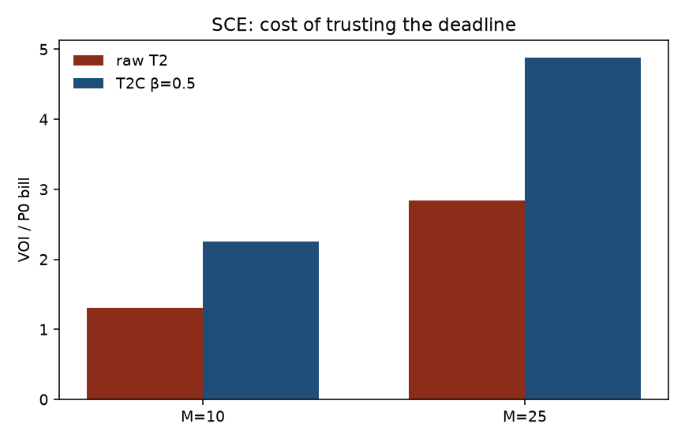

# EV Fleet Charging Intelligence

[](https://github.com/wuongg/ev-charging-intel/actions/workflows/ci.yml) [](LICENSE) [](pyproject.toml)

Workplace charging: a raw declared deadline on SCE at M=25 costs 284.3% of the charge-on-arrival bill ($103,995 per scenario year); the best non-oracle planning assumption (β=0.25 of empirical actual dwell) still costs 182.3% — actual departure information is worth more than any single tariff line item.



Trace: `results/voi_summary.csv`, `results/voi_corrected_summary.csv`. Figure from `scripts/plot_voi_corrected.py`.

## Results v4 (T2C, headline M=25)

Frozen 2019 bank, plant = recorded disconnect, planner = T2C quantile. CI is mean ± 1.96 se. Trace: `results/metrics_v4_summary.csv`.

| policy | mean reduction vs P0 | 95% CI | unmet | penalty share |
|---|---:|---|---:|---:|
| P0 | 0.0% | [0.0%, 0.0%] | 0.4% | 22.8% |
| P1 | -487.2% | [-499.0%, -475.4%] | 8.0% | 87.4% |
| P2b | 0.0% | [0.0%, 0.0%] | 0.4% | 22.8% |
| P3 | -487.2% | [-499.0%, -475.4%] | 8.0% | 87.4% |
| P4 | 1.4% | [1.3%, 1.5%] | 0.4% | 23.2% |

## Reproduction (v1 → v4)

- v1: 2019 bank, median dwell, M=1000 → gap 2918.4% vs 9.2%.
- v2: declared 2018 bank, plant still clipped at the belief → 1309.5%.
- v3: plant I9, raw declared → 134.7%.
- v4: T2C β=0.5 → 249.3%. Published 9.2% assumes realistic user inputs. With measured declaration bias the honest gap is 134.7% before calibration and 249.3% after; the delta is the finding. Reproduction stops here.

M-rescore of the same T2C power: 108.3% at M=10, 249.3% at M=25, 704.5% at M=100. The leftover is unmet kWh times M, not a different filler. Trace: `results/reproduction.csv`.

## Findings

- **Trust contract.** Median declared dwell is 0.29 h *shorter* than the stay; 37.5% of sessions declare *later*. T2C fits actual dwell given hour and declared-gap bucket on the complementary session fold. β=0.5 was not moved to shrink VOI. Sensitivity β in {0.25, 0.5, 0.75} is in `results/voi_corrected_summary.csv`.
- **VOI.** Raw declared pays 284.3% of P0 on SCE M=25. The best non-oracle planning assumption (β=0.25 of the empirical actual-departure distribution) still pays 182.3% (M=10: 84.5%). Median actual (β=0.5) pays 488.6% because that point is the wrong place on the dial; the dial needs a low β. Trace: `results/voi_corrected_summary.csv`. ADR-004.
- **Risk knob.** Safety here is assuming little time. T2C unmet at β=0.25 / 0.5 / 0.75 is 3.2% / 7.9% / 15.5%. A longer belief lets cheapest-slot wait after the car has left.
- **Negative result.** P3 matches P1 whenever 150 kW does not bind. Tightest cell 60 kW ×4: LP cheaper than greedy by 12247 (p=6.4e-15). No cell in the grid saves 1% versus greedy as a break-even cap.
- **Plant semantics.** Before I9, P0 unmet was 18.7%. After, 0.36%. Day-4/5 penalty numbers are the plant-bug record.
- **Dwell × tariff.** On energy cost, charging intelligence pays when median dwell ≥ 5.2 h at spread factor 1 — below 2.6 h the right lever is compliance/capacity, not scheduling. The total bill stays penalty-dominated. Scenario analysis. Trace: `results/dwell_tariff_map.csv`.
- **Sobol.** dwell_scale total-order index 0.91; dwell 0.91. The scheduler's marginal value is conditional on dwell_scale. Scenario analysis. Trace: `results/sobol_indices.csv`.
- **Capacity dual.** Shadow price at binding hours ≈ $0.006/kW-epoch (ε=0.01, one day). Trace: `results/dlmp_summary.csv`.
- **Drift.** Detected with same month delay (9 false-triggers; `acn_2018_2020_proxy`). Refit after a 14-day pinball-ratio trigger cut pinball by 68%. The same detector that triggers my forecast retrain is the drift-monitoring pattern their JD asks for. Trace: `results/drift_twente.csv`, `results/retrain_demo.csv`.
- **VN outage (S1, assumed).** Under simulated unannounced outages (VN pattern), scheduler absorbs 66% of disruption via next-epoch re-solve; the irrecoverable loss is exactly the energy whose deadlines fell inside the outage — bounded and measured, not denied. P0 unmet 38.8→89.0 kWh; I1 holds. Trace: `results/vn_outage_demo.csv`.

## Where an LLM fits and where it doesn't

Fits: tariff YAML, the 90-second script, eval harnesses. Does not fit: the MPC, plant gate, leakage control, freeze hashes, or any README number (`scripts/make_report.py` from `results/*.csv`).

## Skills → roles

| skill shown here | maps to |
|---|---|
| LLM + eval + forecasting (rolling-origin, embargo, pinball) | VinSmart Future |
| constraint opt, edge replay, 15-min MPC, min-cost-flow satellite | VinFast |
| drift, freeze gates, MLOps, time-series regime split | VinDynamics |

## Three interview numbers

1. VOI SCE M=25: 284.3% raw declared; 182.3% at β=0.25 (best non-oracle).
2. Minimum site cap that serves the bank years: 79.6 kW (mean year); 84.7 kW serves every bank day.
3. P0 unmet 18.7% → 0.36% after the plant was the plug, not the belief (I9).

## Reproduce

```bash
uv sync --frozen
uv run pytest -q
uv run python scripts/make_report.py
```

Frozen tag: `v0.7-week1-frozen`. Apply-ready tag: `v0.8-week2-apply-ready`. Amendments after v0.7 are recorded in `docs/PROTOCOL.md`. Full tables: [`docs/report.md`](docs/report.md). Result index: [`results/RESULTS_INDEX.md`](results/RESULTS_INDEX.md).
